<h1 align="center">PolyDual</h1>

<p align="center">Regular polyhedra becoming their duals, one cut at a time.</p>

<p align="center"><strong>English</strong> · <a href="README_CN.md">简体中文</a></p>

<p align="center">
  <picture>
    <source media="(prefers-color-scheme: dark)" srcset="output/dark/D3_N12_M20.svg" />
    <source media="(prefers-color-scheme: light)" srcset="output/light/D3_N12_M20.svg" />
    
  </picture>
</p>

<p align="center">Synchronized cuts · Smooth starts and stops · Hidden edges · Automatic light/dark colors</p>

[Quick start](#quick-start) · [Animations](#animations) · [Mathematics](#mathematics) · [Configuration](#configuration)

## Quick start

Use **Node.js 24+**. No package installation is required.

```sh
npm run generate
```

By default, each of the three animations is generated in both `output/light/` and `output/dark/`, with matching filenames. Open the desired version in a browser with SVG/SMIL support. Each file is self-contained: transparent background, no visible labels, no scripts, and no external assets.

The default loop lasts **11.6 seconds**: two 5-second cuts and a 0.8-second hold at each endpoint. The solid keeps rotating during holds.

## Animations

For an initial solid with `N` faces and `M` vertices, the dual has `M` faces and `N` vertices. Filenames describe the **initial** solid: `D<dimension>_N<faces>_M<vertices>.svg`.

| Initial solid → dual → initial solid | Faces / vertices | Open animation |
| --- | --- | --- |
| Tetrahedron → dual tetrahedron → tetrahedron | 4 / 4 ↔ 4 / 4 | [Light](output/light/D3_N4_M4.svg) · [Dark](output/dark/D3_N4_M4.svg) |
| Cube → octahedron → cube | 6 / 8 ↔ 8 / 6 | [Light](output/light/D3_N6_M8.svg) · [Dark](output/dark/D3_N6_M8.svg) |
| Dodecahedron → icosahedron → dodecahedron | 12 / 20 ↔ 20 / 12 | [Light](output/light/D3_N12_M20.svg) · [Dark](output/dark/D3_N12_M20.svg) |

Green identifies the initial solid's faces; red identifies its dual's faces. Existing faces keep their color as they shrink, while newly cut faces grow in the other color. The return trip is computed as another cut.

## Mathematics

### 1. A solid as an intersection of half-spaces

Place a convex regular polyhedron $`P`$ at the origin and normalize its circumradius to $`1`$. Let $`\mathbf{v}_i`$ be its unit vertex vectors, $`\mathbf{n}_f`$ its outward unit face normals, and $`h`$ its inradius. Then

```math
P=\bigcap_{f=1}^{N}\left\{\mathbf{x}\in\mathbb{R}^3:\mathbf{n}_f^\top\mathbf{x}\le h\right\}.
```

Each vertex supplies a cutting plane perpendicular to its radius. The plane starts at that vertex, and the half-space containing the center is retained. The remaining solid is

```math
K(u)=P\cap\bigcap_{i=1}^{M}
\left\{\mathbf{x}:\mathbf{v}_i^\top\mathbf{x}\le d(u)\right\}.
```

Here $`u`$ is the elapsed fraction of **one complete cut**, with $`0\le u\le1`$; endpoint holds are excluded.

### 2. Why the cut stops at h²

The polar dual is

```math
\begin{aligned}
P^\circ
&=\left\{\mathbf{y}:\mathbf{v}_i^\top\mathbf{y}\le1,\ i=1,\ldots,M\right\} \\
&=\mathrm{conv}\left\{\frac{\mathbf{n}_f}{h}\right\}_{f=1}^{N}.
\end{aligned}
```

At cutting-plane distance $`d=h^2`$, the new half-spaces enclose

```math
\begin{aligned}
h^2P^\circ&=\mathrm{conv}\{h\mathbf{n}_f\}_{f=1}^{N}\subseteq P, \\
K(1)&=h^2P^\circ.
\end{aligned}
```

The inclusion follows from $`\mathbf{n}_g^\top(h\mathbf{n}_f)\le h`$ for unit normals. Thus the original face constraints become redundant, and the result is exactly the regular dual. Its unscaled circumradius is $`h`$.

| Initial solid | Exact stop distance h² |
| --- | --- |
| Tetrahedron | 1/9 |
| Cube | 1/3 |
| Dodecahedron | (5 + 2√5) / 15 |

The endpoint comes from geometry, rather than an area threshold or a visual approximation.

### 3. Smooth cutting speed

The default quintic easing curve is

```math
\begin{aligned}
E(u)&=6u^5-15u^4+10u^3, \\
d(u)&=1-(1-h^2)E(u).
\end{aligned}
```

Its derivative is $`E'(u)=30u^2(1-u)^2`$, so

```math
\begin{aligned}
E(0)&=0,\qquad E(1)=1, \\
E'(0)&=E'(1)=E''(0)=E''(1)=0.
\end{aligned}
```

The target motion starts and stops with zero velocity and acceleration. One easing curve spans the entire cut; a geometric topology boundary at progress $`s_b`$ is scheduled at clock fraction $`E^{-1}(s_b)`$. This keeps intermediate topology changes moving through the same speed profile.

Set `cutEasing` to `"linear"` for constant plane speed. SVG paths approximate the target motion with sampled linear interpolation.

### 4. Constant size and continuous rotation

To keep the solid from shrinking, normalize each intermediate vertex by the current circumradius:

```math
\begin{aligned}
r(u)&=\max_{\mathbf{x}\in\mathrm{vert}K(u)}\lVert\mathbf{x}\rVert_2, \\
\widehat{\mathbf{x}}&=\frac{\mathbf{x}}{r(u)}.
\end{aligned}
```

The normalized solid is rotated about the configured axis and projected orthographically. Over a full loop of duration $`T=2(\tau+\delta)`$,

```math
\theta(t)=2\pi k\,\frac{t}{T},
\qquad k\in\mathbb{Z}\setminus\{0\}.
```

Here $`\tau`$ is the cutting duration, $`\delta`$ the endpoint hold, and $`k`$ the number of turns. Integer turns restore the orientation at the loop boundary. Lighting follows the rotated face normals; occluded edges are dashed.

## Configuration

Edit [polydual.config.json](polydual.config.json), then regenerate.

- `defaults` defines shared rendering and motion settings.
- `animations` enables each pair and overrides individual settings.
- `out` selects the output directory, relative to the configuration file.

For example, replace `animations.tetrahedron` with:

```json
{
  "enabled": true,
  "seconds": 7,
  "cutEasing": "smootherstep",
  "rotation": { "axis": [0.35, 1, -0.25] }
}
```

Overrides merge nested `rotation`, `hiddenEdges`, and theme palettes. Unlisted or disabled animations are skipped; existing files are kept. At least one animation must be enabled.

<details>
<summary><strong>Full configuration reference</strong></summary>

All fields under `defaults` are required. Unknown fields and invalid values produce an error.

| Field | Meaning | Default |
| --- | --- | --- |
| `seconds` | Seconds per cut; positive | `5` |
| `hold` | Seconds held at each endpoint; nonnegative | `0.8` |
| `cutEasing` | `smootherstep` or `linear` | `smootherstep` |
| `samples` | Initial geometry samples per second; positive integer | `60` |
| `size` | SVG width and height in pixels; positive integer | `640` |
| `view` | Direction from center to viewer | `[4, -0.9, 2]` |
| `light` | Direction from center to fixed world-space light | `[-3, 5, 6]` |
| `colors.mode` | `auto` exports both themes; `light` or `dark` exports only that theme | `auto` |
| `colors.light.fill` | Initial-solid color in light mode | `#5faf7d` |
| `colors.light.dualFill` | Dual-solid color in light mode | `#d96b6b` |
| `colors.light.stroke` | Edge color in light mode | `#33473d` |
| `colors.dark.fill` | Initial-solid color in dark mode | `#8bd5a0` |
| `colors.dark.dualFill` | Dual-solid color in dark mode | `#e87979` |
| `colors.dark.stroke` | Edge color in dark mode | `#d8dee9` |
| `strokeWidth` | Visible-edge width; nonnegative | `1.25` |
| `hiddenEdges.enabled` | Show occluded edges as dashes | `true` |
| `hiddenEdges.dash` | Positive dash and gap lengths | `[5, 4]` |
| `hiddenEdges.opacity` | Hidden-edge opacity, from 0 to 1 | `0.5` |
| `hiddenEdges.width` | Hidden-edge width; positive | `1` |
| `rotation.enabled` | Rotate the solid | `true` |
| `rotation.axis` | Nonzero axis through the center | `[0.35, 1, -0.25]` |
| `rotation.turns` | Nonzero integer turns per loop; negative reverses direction | `1` |

Vectors must be finite and nonzero; `view` cannot be parallel to the world Y axis. Colors accept opaque `#RGB` or `#RRGGBB`. Widths use internal 640 × 640 canvas units and scale with the image.

The default axis is tilted about 23° from vertical, with an approximately 11° upward camera view. `view[1]` controls camera height: negative looks upward, positive looks downward.

`auto` exports two fixed-palette versions into the output directory's `light/` and `dark/` subdirectories. `light` or `dark` exports only its corresponding subdirectory. The SVGs do not detect themes internally; the README uses `<picture>` with `prefers-color-scheme` to select a file, falling back to the light version when unsupported.

</details>

Command-line values override animation settings, which override `defaults`:

```sh
npm run generate -- --config polydual.config.json --out output --seconds 6 --hold 1 --samples 60 --size 800
```

`--config` and `--out` are relative to the current working directory. Configuration-file `out` is relative to that file. Run `npm run generate -- --help` for all flags.

## Compact SVGs

The generator removes content that stays invisible throughout its stage, replaces constant animation tracks with static attributes, and simplifies shared geometry/lighting keyframes. Stage boundaries, holds, and silhouette events are retained.

The simplification budget is **0.04 internal pixels**, plus at most about **0.0071 pixels** from two-decimal coordinate rounding. Relative to the initial sampled trajectories, total position error stays below **0.05 pixels** and opacity error stays within **0.002**. Initial sampling error is separate; positional errors scale with displayed size.

`samples: 60` describes the initial sampling density. Browsers continuously interpolate the exported keyframes; actual playback FPS depends on the browser and device.

## Verification

```sh
npm test
```

Checks cover regular dual endpoints, clipping constraints, planar faces, radius normalization, rotation, hidden-edge occlusion, color continuity, complete loop timing, easing and inverse topology timing, SMIL validity, and bounded optimization error. Linear, eased, stationary, and reverse-rotation cases are included.

| Source | Responsibility |
| --- | --- |
| [geometry.ts](src/geometry.ts) | Convex geometry, clipping stages, file naming |
| [motion.ts](src/motion.ts) | Easing, inverse timing, rotation, silhouette events |
| [optimize.ts](src/optimize.ts) | Visibility windows and bounded keyframe simplification |
| [svg.ts](src/svg.ts) | Projection, colors, lighting, SMIL export |
| [config.ts](src/config.ts) · [generate.ts](src/generate.ts) | Validation and command-line generation |
