<h1 align="center">PolyDual</h1>

<p align="center">以连续切割，呈现正多面体与对偶之间的变换。</p>

<p align="center"><a href="README.md">English</a> · <strong>简体中文</strong></p>

<p align="center">
  <picture>
    <source media="(prefers-color-scheme: dark)" srcset="output/dark/D3_N12_M20.svg" />
    <source media="(prefers-color-scheme: light)" srcset="output/light/D3_N12_M20.svg" />
    
  </picture>
</p>

<p align="center">同步切割 · 平滑启停 · 遮挡虚线 · 明暗主题自适应</p>

[快速开始](#快速开始) · [动画](#动画) · [数学原理](#数学原理) · [配置](#配置)

## 快速开始

需要 **Node.js 24+**，无需安装依赖。

```sh
npm run generate
```

默认在 `output/light/` 和 `output/dark/` 下各生成三组固定主题的动画；两个目录中的文件名相同。用支持 SVG/SMIL 的浏览器打开对应版本即可播放。每个 SVG 都可以独立使用：背景透明、没有可见文字，不依赖脚本或外部资源。

默认一轮 **11.6 秒**：两次各 5 秒的切割，以及每个端点 0.8 秒的停留。停留时只暂停切割，物体继续旋转。

## 动画

初始多面体有 `N` 个面、`M` 个顶点，对偶则有 `M` 个面、`N` 个顶点。文件名记录**初始状态**：`D维度_N面数_M顶点数.svg`。

| 初始多面体 → 对偶 → 初始多面体 | 面数 / 顶点数 | 打开动画 |
| --- | --- | --- |
| 四面体 → 对偶四面体 → 四面体 | 4 / 4 ↔ 4 / 4 | [明亮](output/light/D3_N4_M4.svg) · [暗黑](output/dark/D3_N4_M4.svg) |
| 立方体 → 八面体 → 立方体 | 6 / 8 ↔ 8 / 6 | [明亮](output/light/D3_N6_M8.svg) · [暗黑](output/dark/D3_N6_M8.svg) |
| 十二面体 → 二十面体 → 十二面体 | 12 / 20 ↔ 20 / 12 | [明亮](output/light/D3_N12_M20.svg) · [暗黑](output/dark/D3_N12_M20.svg) |

绿色表示初始多面体的面，红色表示对偶的面。原有面保持颜色、逐渐缩小，新切面以另一种颜色长大；返程根据新的顶点重新切割。

## 数学原理

### 1. 用半空间交集表示多面体

将凸正多面体 $P$ 的中心置于原点，并把外接球半径归一化为 $1$。记单位顶点向量为 $\mathbf v_i$，各面的外向单位法向量为 $\mathbf n_f$，内切球半径为 $h$，则

$$
P=\bigcap_{f=1}^{N}\left\{\mathbf x\in\mathbb R^3:\mathbf n_f^\top\mathbf x\le h\right\}.
$$

每个顶点对应一个垂直于其半径的切割平面。平面从顶点出发，始终保留包含中心的半空间，剩余实体为

$$
K(u)=P\cap\bigcap_{i=1}^{M}
\left\{\mathbf x:\mathbf v_i^\top\mathbf x\le d(u)\right\},
\qquad 0\le u\le1.
$$

这里 $u$ 是**整次切割**经过的时间比例，不包含端点停留。

### 2. 为什么在 $h^2$ 处停止？

极对偶定义为

$$
P^\circ=\left\{\mathbf y:\mathbf v_i^\top\mathbf y\le1,\ i=1,\ldots,M\right\}
=\operatorname{conv}\left\{\frac{\mathbf n_f}{h}\right\}_{f=1}^{N}.
$$

其中 $\operatorname{conv}$ 表示凸包。当切割平面到中心的距离为 $d=h^2$ 时，新半空间围成

$$
h^2P^\circ=\operatorname{conv}\{h\mathbf n_f\}_{f=1}^{N}\subseteq P,
\qquad K(1)=h^2P^\circ.
$$

因为法向量均为单位向量，所以 $\mathbf n_g^\top(h\mathbf n_f)\le h$，上述包含关系成立。此时原有面的约束已经冗余，剩余实体恰好是正多面体的对偶，未放大的外接球半径为 $h$。

| 初始多面体 | 精确停止距离 $h^2$ |
| --- | --- |
| 四面体 | $1/9$ |
| 立方体 | $1/3$ |
| 十二面体 | $(5+2\sqrt5)/15$ |

因此，终点由几何关系确定，无需用面面积阈值或画面近似来判断。

### 3. 让切割速度平滑启停

默认使用五次缓动曲线：

$$
E(u)=6u^5-15u^4+10u^3,
\qquad d(u)=1-(1-h^2)E(u).
$$

它的导数为 $E'(u)=30u^2(1-u)^2$，因此

$$
E(0)=0,\quad E(1)=1,\quad
E'(0)=E'(1)=E''(0)=E''(1)=0.
$$

理想切割轨迹在起点和终点的速度、加速度都为零。整次切割使用同一条缓动曲线；几何拓扑在进度 $s_b$ 处发生变化时，对应的时钟比例为 $E^{-1}(s_b)$，使中途换面仍沿同一速度曲线衔接。

将 `cutEasing` 设为 `"linear"` 可以使用恒定平面速度。SVG 路径通过采样和线性插值近似上述连续轨迹。

### 4. 保持尺寸与循环旋转

为避免越切越小，每个中间顶点都按当前外接球半径归一化：

$$
r(u)=\max_{\mathbf x\in\operatorname{vert}K(u)}\|\mathbf x\|_2,
\qquad \widehat{\mathbf x}=\frac{\mathbf x}{r(u)}.
$$

其中 $\operatorname{vert}K(u)$ 表示中间实体的顶点集合，$\|\cdot\|_2$ 表示欧氏长度。归一化后的实体绕配置的轴旋转，再做正交投影。完整周期为 $T=2(\tau+\delta)$ 时，

$$
\theta(t)=2\pi k\,\frac{t}{T},
\qquad k\in\mathbb Z\setminus\{0\}.
$$

$\tau$ 是每次切割时长，$\delta$ 是端点停留时长，$k$ 是每周期圈数。整数圈保证循环时朝向恢复；光照跟随旋转后的面法向量更新，被遮挡的棱使用虚线。

## 配置

修改 [polydual.config.json](polydual.config.json)，再重新生成。

- `defaults` 设置公共渲染与运动参数。
- `animations` 启用各组动画，并按需覆盖参数。
- `out` 设置输出目录，相对路径以配置文件所在目录为基准。

例如，可将 `animations.tetrahedron` 改为：

```json
{
  "enabled": true,
  "seconds": 7,
  "cutEasing": "smootherstep",
  "rotation": { "axis": [0.35, 1, -0.25] }
}
```

`rotation`、`hiddenEdges` 和主题配色支持子字段覆盖。未列出或禁用的动画会跳过，已有文件保留；至少需要启用一组。

<details>
<summary><strong>完整配置字段</strong></summary>

`defaults` 中的所有字段均需填写。未知字段或无效参数会直接报错。

| 字段 | 含义 | 默认值 |
| --- | --- | --- |
| `seconds` | 每次切割秒数，大于 0 | `5` |
| `hold` | 每个端点停留秒数，不小于 0 | `0.8` |
| `cutEasing` | `smootherstep` 平滑启停，或 `linear` 等速 | `smootherstep` |
| `samples` | 初始几何采样数/秒，正整数 | `60` |
| `size` | SVG 宽高像素，正整数 | `640` |
| `view` | 从中心指向观察者的方向 | `[4, -0.9, 2]` |
| `light` | 从中心指向固定世界光源的方向 | `[-3, 5, 6]` |
| `colors.mode` | `auto` 生成两套，`light` 或 `dark` 只生成指定主题 | `auto` |
| `colors.light.fill` | 明亮主题下初始多面体的基色 | `#5faf7d` |
| `colors.light.dualFill` | 明亮主题下对偶多面体的基色 | `#d96b6b` |
| `colors.light.stroke` | 明亮主题下的棱线色 | `#33473d` |
| `colors.dark.fill` | 暗黑主题下初始多面体的基色 | `#8bd5a0` |
| `colors.dark.dualFill` | 暗黑主题下对偶多面体的基色 | `#e87979` |
| `colors.dark.stroke` | 暗黑主题下的棱线色 | `#d8dee9` |
| `strokeWidth` | 可见棱线宽，不小于 0 | `1.25` |
| `hiddenEdges.enabled` | 是否用虚线显示被遮挡的棱 | `true` |
| `hiddenEdges.dash` | 大于 0 的虚线长度、间隔 | `[5, 4]` |
| `hiddenEdges.opacity` | 虚线不透明度，范围 0–1 | `0.5` |
| `hiddenEdges.width` | 虚线宽度，大于 0 | `1` |
| `rotation.enabled` | 是否旋转物体 | `true` |
| `rotation.axis` | 经过中心的非零旋转轴 | `[0.35, 1, -0.25]` |
| `rotation.turns` | 每周期非零整数圈数，负数反转 | `1` |

方向向量的分量必须有限，且向量非零；`view` 不能与世界坐标 Y 轴平行。颜色支持不透明的 `#RGB`、`#RRGGBB`。线宽以内部 640 × 640 画布为单位，随图像同比缩放。

默认旋转轴相对竖直方向倾斜约 23°，相机仰视约 11°。`view[1]` 控制观察高度：负值仰视，正值俯视。

`auto` 分别导出明亮和暗黑两个固定配色的版本，存入输出目录的 `light/` 和 `dark/` 子目录。`light` 或 `dark` 仅导出对应子目录。SVG 本身不再检测主题；README 通过 `<picture>` 的 `prefers-color-scheme` 媒体查询选择文件，不支持时回退到明亮版本。

</details>

参数优先级为：命令行 > 单组动画配置 > `defaults`。

```sh
npm run generate -- --config polydual.config.json --out output --seconds 6 --hold 1 --samples 60 --size 800
```

`--config`、`--out` 相对于当前工作目录；配置文件中的 `out` 相对于该文件。全部选项可通过 `npm run generate -- --help` 查看。

## SVG 精简

生成器删除阶段内始终不可见的内容，将常量动画改成静态属性，并对共享的几何、阴影轨迹精简关键帧。切割阶段边界、停留边界与轮廓事件都会保留。

精简的位置误差预算为 **0.04 个内部像素**，两位小数的坐标取整最多再增加约 **0.0071 像素**。相对初始采样轨迹，总位置误差控制在 **0.05 像素**内，阴影不透明度误差不超过 **0.002**。初始采样误差另计，位置误差随显示尺寸同比缩放。

`samples: 60` 表示初始采样密度。浏览器持续插值输出关键帧，实际播放 FPS 取决于浏览器和设备。

## 验证

```sh
npm test
```

检查包括：正多面体对偶终点、切割半空间、面共面性、半径归一化、旋转、遮挡虚线、颜色连续性、完整循环、缓动与拓扑边界的逆时间映射、SMIL 格式及精简误差。覆盖等速、缓动、静止视角与反向旋转。

| 源码 | 职责 |
| --- | --- |
| [geometry.ts](src/geometry.ts) | 凸几何、切割分段与文件名 |
| [motion.ts](src/motion.ts) | 缓动、逆时间映射、旋转与轮廓事件 |
| [optimize.ts](src/optimize.ts) | 可见区间与误差有界的关键帧精简 |
| [svg.ts](src/svg.ts) | 投影、配色、光照与 SMIL 输出 |
| [config.ts](src/config.ts) · [generate.ts](src/generate.ts) | 配置校验与命令行生成 |
